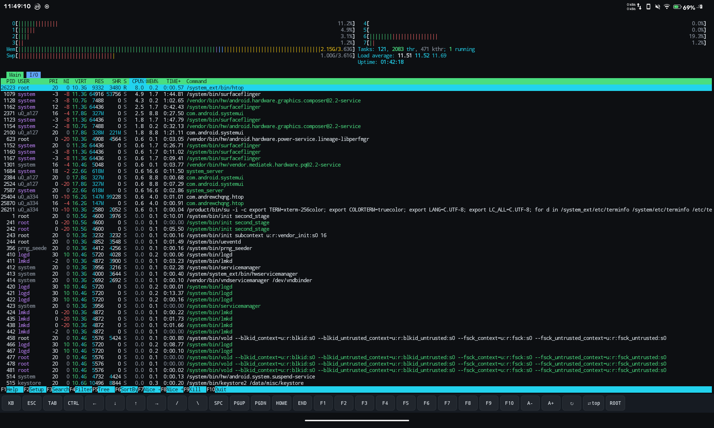
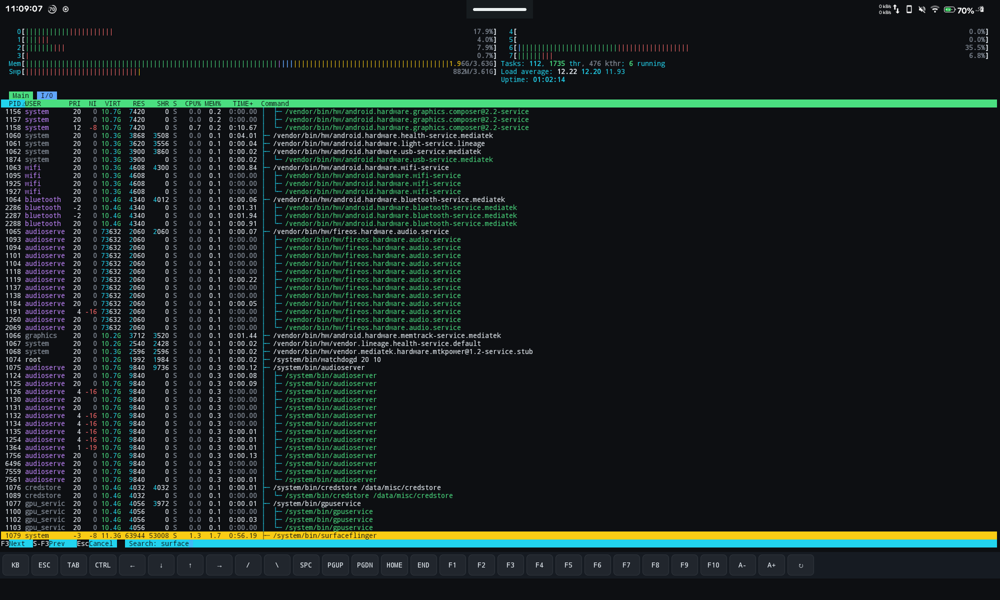
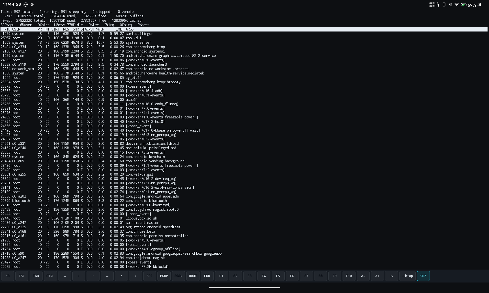

# Android htop GUI — Native Process Monitor & Task Manager (Root, Shizuku & LineageOS)

**`android-htop-gui`** is a lightweight, zero-permission native **Android `htop` GUI, process viewer, and system task manager**. It runs `htop` or `top` inside a C JNI pseudo-terminal (`/dev/ptmx` PTY) — supporting **Root (`su` / Magisk / KernelSU / APatch)**, **[Shizuku](https://shizuku.rikka.app/) (no root required, ADB / wireless debugging)**, and **Non-Root (`USER`)** modes — with full **touchscreen**, **hardware mouse/scroll wheel**, **hardware keyboard**, **virtual keyboard (IME)**, and **extra-keys toolbar** passthrough.

Works out of the box on **LineageOS** and custom ROMs with `/system_ext/bin/htop` preinstalled, **and** ships a self-contained **bundled `htop 3.5.3`** binary ([`arter97/android-htop`](https://github.com/arter97/android-htop) with statically linked `ncurses` and compiled-in `xterm-256color` terminfo) for stock Android / Pixel / Samsung / AOSP devices without `htop`.

<p>
  <a href="https://apps.obtainium.imranr.dev/redirect?r=obtainium://app/%7B%22id%22%3A%22com.andrewchqng.htop%22%2C%22url%22%3A%22https%3A%2F%2Fgithub.com%2FAndrewChqng%2Fandroid-htop-gui%22%2C%22author%22%3A%22AndrewChqng%22%2C%22name%22%3A%22Android%20htop%22%2C%22additionalSettings%22%3A%22%7B%5C%22includePrereleases%5C%22%3Afalse%2C%5C%22fallbackToOlderReleases%5C%22%3Atrue%2C%5C%22autoApkFilterByArch%5C%22%3Atrue%7D%22%7D"></a>
</p>



---

## Key Features

- **3 Execution Backends (`ROOT` / `SHZ` / `USER`)**:
  - **`ROOT` (`su`)**: Full `/proc` process & thread visibility, per-core CPU/RAM/swap meters, process priority renicing (`F7`/`F8`), and signal/kill (`F9`) via MagiskSU, KernelSU, or APatch.
  - **`SHZ` ([Shizuku](https://shizuku.rikka.app/))**: Runs a privileged `ShizukuPtyService` (`UserService`) under Android's `shell` UID (`2000`, `readproc` group) or root — view system processes on unrooted devices using wireless debugging or ADB.
  - **`USER` (Non-Root)**: Unprivileged app sandbox execution (Android 10–17 W^X compliant via `jniLibs` native library extraction).
- **3 Process Monitor Binaries (`HTOP` / `BND` / `TOP`)**:
  - **`HTOP` (System `htop`, default)**: Launches the ROM's built-in `htop` (`/system_ext/bin/htop` on LineageOS, `/system/bin/htop`, `/system/xbin/htop`, `/data/local/tmp/htop`, or Termux `htop`).
  - **`BND` (Bundled `htop 3.5.3` via [`arter97/android-htop`](https://github.com/arter97/android-htop))**: Self-contained Android `htop` executable (`libhtop_bundled.so`) with compiled-in `ncurses` terminfo fallbacks (`xterm-256color`, `vt100`, etc.) — works on stock ROMs with zero external dependencies and **no `INTERNET` permission**.
  - **`TOP` (System `top`)**: Launches Android's built-in `/system/bin/top -d 1`.
- **Touch, Mouse & Keyboard TUI Control**:
  - **Touch**: Tap any process row, column header (to sort by `CPU%`, `MEM%`, `PID`, `TIME+`), or `F1`–`F10` footer key (`SGR 1006` mouse reporting); drag vertically to scroll; drag horizontally to pan command lines; pinch-to-zoom font size (`7sp`–`28sp`) with live `TIOCSWINSZ` / `SIGWINCH` terminal reflow.
  - **Extra-Keys Toolbar**: Leading **`ROOT`/`SHZ`/`USER`** and **`HTOP`/`BND`/`TOP`** popup pickers, virtual keyboard toggle (`KB`), `ESC`, `TAB`, sticky `CTRL`, auto-repeating arrow keys (`←`/`↓`/`↑`/`→`), `/`, `\`, `SPC`, `PGUP`, `PGDN`, `HOME`, `END`, `F1`–`F10`, font zoom (`A-`/`A+`), and session restart (`↻`).
  - **Hardware Peripherals**: Full USB/Bluetooth keyboard (`F1`–`F12`, `Ctrl`/`Alt`/`Shift` combos) and mouse click + scroll wheel (`AXIS_VSCROLL`/`AXIS_HSCROLL`) support for Android tablets, foldables, DeX, and desktop mode.

---

## Screenshots

| Root Mode (`ROOT` + System `HTOP` on LineageOS) | Shizuku Mode (`SHZ` + Bundled `BND` `F5` Tree View) |
| :---: | :---: |
|  |  |
| **`ROOT` + `HTOP`** — native `/system_ext/bin/htop` with full `/proc` visibility and leading toolbar pickers | **`SHZ` + `BND`** — bundled `arter97/android-htop 3.5.3` in `F5` process tree view via Shizuku (no root) |

| Interactive `F3` Process Search | Built-in Android `top` Mode (`SHZ` + `TOP`) |
| :---: | :---: |
|  |  |
| Live **`F3` Search** (`F4` filter, `F6` sort, pinch-zoom & touch scroll/tap) | **`SHZ` + `TOP`** — Android `/system/bin/top -d 1` selectable anytime from the toolbar picker |

---

## Download & Install

### Option 1: Obtainium (Recommended for Auto-Updates)
Click the **[Get it on Obtainium](https://apps.obtainium.imranr.dev/redirect?r=obtainium://app/%7B%22id%22%3A%22com.andrewchqng.htop%22%2C%22url%22%3A%22https%3A%2F%2Fgithub.com%2FAndrewChqng%2Fandroid-htop-gui%22%2C%22author%22%3A%22AndrewChqng%22%2C%22name%22%3A%22Android%20htop%22%2C%22additionalSettings%22%3A%22%7B%5C%22includePrereleases%5C%22%3Afalse%2C%5C%22fallbackToOlderReleases%5C%22%3Atrue%2C%5C%22autoApkFilterByArch%5C%22%3Atrue%7D%22%7D)** badge above or add `https://github.com/AndrewChqng/android-htop-gui` in [Obtainium](https://github.com/ImranR98/Obtainium). With architecture filtering enabled, Obtainium automatically downloads the slim per-ABI APK for your device.

### Option 2: GitHub Releases (Per-ABI Split APKs, Universal APK, or `.apks`)
Download the latest v2/v3-signed package from [**GitHub Releases**](https://github.com/AndrewChqng/android-htop-gui/releases/latest):

| Package | Size | Target Devices |
| :--- | :---: | :--- |
| `android-htop-gui-v*-arm64-v8a-release.apk` | ~396 KB | Modern 64-bit ARM phones & tablets (`arm64-v8a`) |
| `android-htop-gui-v*-armeabi-v7a-release.apk` | ~374 KB | 32-bit ARM devices (`armeabi-v7a`) |
| `android-htop-gui-v*-x86_64-release.apk` | ~400 KB | `x86_64` tablets, ChromeOS, Waydroid & Android emulators |
| `android-htop-gui-v*-universal-release.apk` | ~922 KB | Universal standalone APK containing all ABIs |
| `android-htop-gui-v*-release.apks` | ~961 KB | Split APK Set archive for Obtainium, SAI, App Manager & `bundletool` |

---

## Execution Backends & Monitor Modes

Select both the **execution backend** (`ROOT` / `SHZ` / `USER`) and **monitor binary** (`HTOP` / `BND` / `TOP`) manually via the two leading pills at the far left of the extra-keys toolbar or from the session exit banner. Your choices persist across launches (no unexpected silent fallbacks).

| Toolbar Pill | Options | Description |
| :--- | :--- | :--- |
| **Backend (`ROOT` / `SHZ` / `USER`)** | `Root (su)` · `Shizuku` · `Non-Root` | Controls whether the PTY shell runs via `su -i -c` (Root), `ShizukuPtyService` (`shell` UID 2000 / root), or the unprivileged app UID. |
| **Monitor (`HTOP` / `BND` / `TOP`)** | `System htop` · `Bundled htop (arter97)` · `System top` | Selects the device's ROM `htop`, the bundled self-contained `htop 3.5.3` (`libhtop_bundled.so`), or `/system/bin/top -d 1`. |

You can also launch a specific combination directly over `adb`:

```bash
# Root + System htop
adb shell am start -n com.andrewchqng.htop/.MainActivity --es backend root --es mode htop

# Shizuku + Bundled htop 3.5.3 (no root or ROM htop required)
adb shell am start -n com.andrewchqng.htop/.MainActivity --es backend shizuku --es mode bundled

# Shizuku + System top
adb shell am start -n com.andrewchqng.htop/.MainActivity --es backend shizuku --es mode top
```

---

## Architecture

- **Native PTY Bridge ([`pty.c`](app/src/main/cpp/pty.c), [`PtyNative.kt`](app/src/main/java/com/andrewchqng/htop/pty/PtyNative.kt), [`PtySession.kt`](app/src/main/java/com/andrewchqng/htop/pty/PtySession.kt))**:
  - Opens `/dev/ptmx` with `TIOCSWINSZ`, `IUTF8`, 16 KB page-size alignment (`-Wl,-z,max-page-size=16384`), and clean FD/signal hygiene before `execve("/system/bin/sh", ...)`.
  - Dedicated reader, writer, and `waitpid` threads keep UI rendering and touch callbacks lock-free.
- **Shizuku `UserService` IPC ([`ShizukuPtyService.kt`](app/src/main/java/com/andrewchqng/htop/shizuku/ShizukuPtyService.kt), [`ShizukuPtySession.kt`](app/src/main/java/com/andrewchqng/htop/shizuku/ShizukuPtySession.kt))**:
  - Runs the native PTY bridge inside Shizuku's privileged process over Binder AIDL with automatic death-recipient cleanup.
- **Command & Environment Builder ([`HtopCommandBuilder.kt`](app/src/main/java/com/andrewchqng/htop/pty/HtopCommandBuilder.kt))**:
  - Exports `TERM=xterm-256color`, `COLORTERM=truecolor`, `LANG=C.UTF-8`, auto-detects device `TERMINFO` (`/system_ext/etc/terminfo`, `/system/etc/terminfo`, Termux), and sets `XDG_CONFIG_HOME` so `htoprc` preferences persist across sessions.
  - Uses `stty raw -echo` + `su -i -c` on MagiskSU (falling back to `su -c`) so `SIGWINCH` window resizes and raw escape sequences propagate cleanly.
- **VT100 / xterm-256color Terminal Emulator & Canvas Renderer ([`TerminalEmulator.kt`](app/src/main/java/com/andrewchqng/htop/terminal/TerminalEmulator.kt), [`TerminalBuffer.kt`](app/src/main/java/com/andrewchqng/htop/terminal/TerminalBuffer.kt), [`TerminalView.kt`](app/src/main/java/com/andrewchqng/htop/ui/TerminalView.kt))**:
  - Alternate screen buffer (`?1049h`/`l`), SGR 16/256/24-bit truecolor, DEC line-drawing & UTF-8 block meters, scroll regions (`DECSTBM`), `DECCKM` (`?1h`/`l`), and SGR 1006 / X10 mouse tracking (`?1006;1000h`).
  - Zero-allocation `Canvas` frame rendering.

---

## Rebuilding & Auto-Updating Bundled `htop`

[`arter97/android-htop`](https://github.com/arter97/android-htop) is mounted as a Git submodule at `third_party/android-htop` and invoked through [`scripts/build-bundled-htop.sh`](scripts/build-bundled-htop.sh), which cross-compiles static `ncurses` + `htop` for `arm64-v8a`, `armeabi-v7a`, and `x86_64`, verifies 16 KB ELF page alignment, installs `app/src/main/jniLibs/<abi>/libhtop_bundled.so`, and writes [`third_party/VERSIONS.txt`](third_party/VERSIONS.txt).

- **Automated CI Sync**: [`.github/workflows/update-bundled-htop.yml`](.github/workflows/update-bundled-htop.yml) runs daily (and on `workflow_dispatch`) to check for new `arter97/android-htop` commits or upstream `htop-dev/htop` releases, rebuilds all `jniLibs`, runs unit tests, and commits updates to `main`.
- **Local Rebuild**:

```bash
ANDROID_NDK_HOME=$HOME/Android/Sdk/ndk/28.2.13676358 \
  ./scripts/build-bundled-htop.sh
```

---

## Build from Source

Requirements: Android SDK (`compileSdk 36`, NDK `28.2.13676358`, CMake `3.22.1`), JDK 21, `adb`.

Builds output per-ABI split APKs (`arm64-v8a`, `armeabi-v7a`, `x86_64`), a combined `universal` APK, and a single-variant `app-<buildType>.apks` archive under `app/build/outputs/apk/<buildType>/`:

```bash
git clone --recurse-submodules https://github.com/AndrewChqng/android-htop-gui.git
cd android-htop-gui
JAVA_HOME=/home/roboy/.jdks/jdk-21 ./gradlew testDebugUnitTest assembleDebug
adb install -r app/build/outputs/apk/debug/app-arm64-v8a-debug.apk
```

### Release Signing

Release builds use APK Signature Scheme v2/v3 (PKCS12, RSA 4096-bit, `isMinifyEnabled = true`, `isShrinkResources = true`, no Google dependency metadata blobs). Copy [`keystore.properties.example`](keystore.properties.example) to a gitignored `keystore.properties` file or export `ANDROID_KEYSTORE_PATH`, `ANDROID_KEYSTORE_PASSWORD`, `ANDROID_KEY_ALIAS`, and `ANDROID_KEY_PASSWORD`, then run:

```bash
JAVA_HOME=/home/roboy/.jdks/jdk-21 ./gradlew testDebugUnitTest assembleRelease
```

---

## Credits & License Notices

The original source code in this repository is licensed under the GNU General Public License v3.0 or later (`GPL-3.0-or-later`). See [`LICENSE`](LICENSE).

See [`THIRD_PARTY_NOTICES.md`](THIRD_PARTY_NOTICES.md) for full open-source attributions ([`arter97/android-htop`](https://github.com/arter97/android-htop), [`htop-dev/htop`](https://github.com/htop-dev/htop) `GPL-2.0-only`, GNU `ncurses`, and [`Shizuku`](https://github.com/RikkaApps/Shizuku-API) `Apache-2.0`).

---

*Built with assistance from Antigravity (Google DeepMind). Experimental root/Shizuku system utility — behavior depends on your device/ROM `htop` or bundled `htop` binary, SELinux policy, and `su`/Shizuku permissions; verify on your target device before relying on it in production workflows.*
