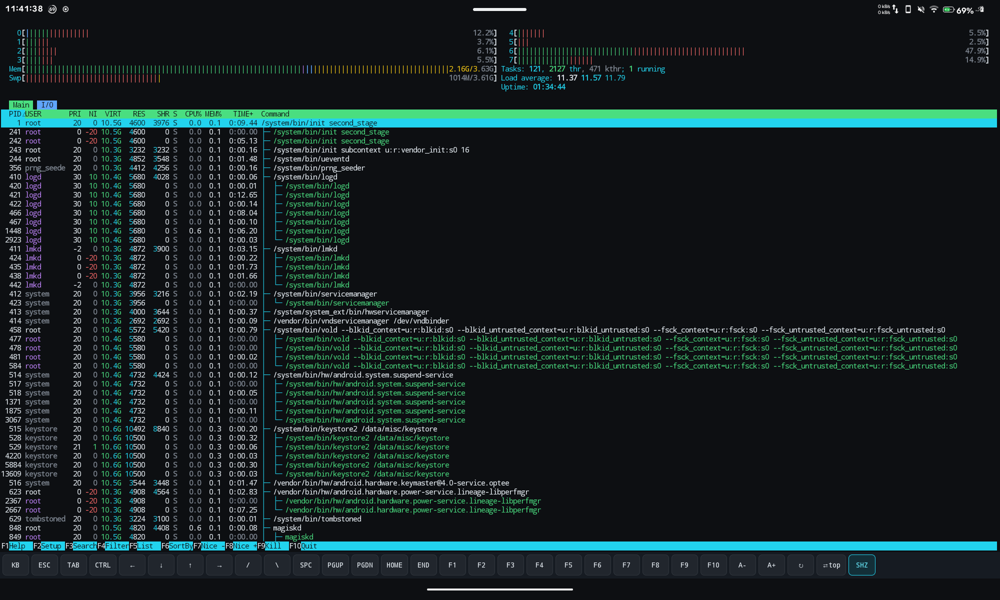

# android-htop-gui

Lightweight native Android application that launches `htop` inside a native pseudo-terminal (PTY) — via root (`su`), [Shizuku](https://shizuku.rikka.app/), or non-root — and passes through touch, hardware mouse/scroll wheel, hardware keyboard, virtual keyboard (IME), and a compact extra-keys toolbar directly to the TUI.


## Requirements & Execution Modes

- **Root Access (`su`) or Shizuku Mode (Optional Non-Root)**: Root (`su`, e.g., MagiskSU / KernelSU) provides full `/proc` visibility and process signaling (`F7`/`F8`/`F9`). Uses `stty raw -echo` + `su -i -c` on MagiskSU for live `SIGWINCH` resize propagation (with automatic fallback to `su -c`).
  - **Shizuku Mode**: When root (`su`) is unavailable or denied and [Shizuku](https://shizuku.rikka.app/) is running (ADB/wireless debugging or root server), the app automatically falls back to a Shizuku `UserService` (`ShizukuPtyService`) running the native `/dev/ptmx` PTY inside Shizuku's privileged `shell` (UID `2000`, `readproc`) or root context. You can cycle `ROOT` / `SHZ` / `USER` manually via the toolbar pill or exit banner.
- **LineageOS / System `htop` with Automatic `top` Fallback**: By default (**`HTOP`** mode), the app looks for the device's local `htop` (`/system_ext/bin/htop`, `/system/bin/htop`, `/system/xbin/htop`, `/data/local/tmp/htop`, or Termux) and automatically falls back to Android's built-in `top` (`/system/bin/top -d 1`) if system `htop` is absent.
- **Optional Bundled `htop` (`arter97/android-htop` 3.5.3)**: On stock or locked-down ROMs without system `htop`, tap the **`HTOP`** / **`BND`** / **`TOP`** mode selector pill in the extra-keys toolbar (or **`Bundled htop`** in the exit banner) to switch to the bundled self-contained `htop 3.5.3` binary packaged via `jniLibs` (`libhtop_bundled.so`, statically linked against `ncurses` with compiled-in fallback terminfo entries, no `INTERNET` permission required). You can also switch cleanly to built-in `top` anytime.

## Screenshots

| Root Mode (`htop` on LineageOS) | Shizuku Mode (`F5` Tree View, No Root) |
| :---: | :---: |
|  |  |
| **`ROOT`** — native `/system_ext/bin/htop` with full `/proc` visibility and extra-keys bar | **`SHZ`** — Shizuku `UserService` PTY + `F5` process tree view without root |

| Interactive `F3` Search | Built-in `top` Fallback (`⇄top` / `⇄htop`) |
| :---: | :---: |
|  |  |
| Live **`F3` Search** (`F4` filter, `F6` sort, pinch-zoom & touch scroll/tap) | Automatic **`top -d 1`** fallback and one-tap live mode switching |

## Architecture & Features

- **Native PTY Bridge ([`pty.c`](app/src/main/cpp/pty.c), [`PtyNative.kt`](app/src/main/java/com/andrewchqng/htop/pty/PtyNative.kt), [`PtySession.kt`](app/src/main/java/com/andrewchqng/htop/pty/PtySession.kt))**:
  - Opens `/dev/ptmx` with `TIOCSWINSZ`, `IUTF8`, and clean FD/signal hygiene before `execve("/system/bin/sh", ...)`.
  - Runs dedicated background reader, writer, and process-waiter threads so UI/touch callbacks never block the main thread.
- **Process Monitor Modes & Command Builder ([`HtopCommandBuilder.kt`](app/src/main/java/com/andrewchqng/htop/pty/HtopCommandBuilder.kt))**:
  - Sets `TERM=xterm-256color`, `COLORTERM=truecolor`, `LANG=C.UTF-8`, auto-detects device `TERMINFO` (e.g., `/system_ext/etc/terminfo`), and points `XDG_CONFIG_HOME` to app-private `files/config` (or `/data/local/tmp/.android-htop-config` under Shizuku) so `htoprc` persists across runs.
  - Supports **System `htop`** (`HTOP`, with automatic fallback to `top -d 1` if missing), **Bundled `htop`** (`BND`, from `nativeLibraryDir/libhtop_bundled.so` with `/data/local/tmp/.android-htop-bundled` fallback for strict SELinux `shell` contexts), and **System `top`** (`TOP`).
  - Uses `stty raw -echo` + `su -i -c` on MagiskSU (falling back to `su -c`) so `SIGWINCH` window resizes and raw input sequences propagate cleanly.
- **VT100 / xterm-256color Emulator & Canvas Renderer ([`TerminalEmulator.kt`](app/src/main/java/com/andrewchqng/htop/terminal/TerminalEmulator.kt), [`TerminalBuffer.kt`](app/src/main/java/com/andrewchqng/htop/terminal/TerminalBuffer.kt), [`TerminalView.kt`](app/src/main/java/com/andrewchqng/htop/ui/TerminalView.kt))**:
  - Supports alternate screen (`?1049h`/`l`), SGR 16/256/24-bit colors, DEC line-drawing & UTF-8, scroll regions (`DECSTBM`), `DECCKM` (`?1h`/`l`), and SGR 1006 / X10 mouse tracking (`?1006;1000h`).
  - Lock-free `Canvas` snapshot rendering with zero per-frame allocations.
- **Full Input Passthrough ([`InputEncoder.kt`](app/src/main/java/com/andrewchqng/htop/ui/InputEncoder.kt), [`ExtraKeysBar.kt`](app/src/main/java/com/andrewchqng/htop/ui/ExtraKeysBar.kt))**:
  - **Touch**: tap rows, column headers, or `F1`–`F10` footer buttons (`SGR 1006` press+release); vertical drag scrolls the list (`wheel 64/65`); horizontal drag pans wide command lines (`Left`/`Right` arrows); two-finger pinch zooms font size (`7sp`–`28sp`) with live `SIGWINCH` reflow.
  - **Hardware Mouse**: left/middle/right clicks, drag tracking, and vertical/horizontal scroll wheel (`AXIS_VSCROLL`/`AXIS_HSCROLL`).
  - **Keyboard & IME**: hardware keyboard (`F1`–`F12`, arrows, `Ctrl` combos, `Alt` combos, `Shift+Tab`), virtual IME (`BaseInputConnection`), and an extra-keys toolbar (`KB`, `ESC`, `TAB`, sticky `CTRL`, repeatable arrows, `F1`–`F10`, `A-`/`A+`, `↻`, `HTOP`/`BND`/`TOP`, `ROOT`/`SHZ`/`USER`).

## Rebuilding Bundled `htop`

Prebuilt stripped `libhtop_bundled.so` binaries (v`3.5.3` with compiled-in terminfo entries) live in `app/src/main/jniLibs/{arm64-v8a,armeabi-v7a,x86_64}/` via [`third_party/android-htop/build.sh`](third_party/android-htop/build.sh) (adapted from [`arter97/android-htop`](https://github.com/arter97/android-htop)). To rebuild them locally:

```bash
ANDROID_NDK_HOME=$HOME/Android/Sdk/ndk/28.2.13676358 \
  third_party/android-htop/build.sh --install-jni
```

## Build & Install

Requirements: Android SDK (`compileSdk 36`, NDK `28.2.13676358`, CMake `3.22.1`), JDK 21, `adb`.

```bash
JAVA_HOME=/home/roboy/.jdks/jdk-21 ./gradlew testDebugUnitTest assembleDebug
adb install -r app/build/outputs/apk/debug/app-debug.apk
adb shell am start -n com.andrewchqng.htop/.MainActivity
```

### Release Signing

Release builds use APK Signature Scheme v2/v3 (PKCS12, RSA 4096-bit, `isMinifyEnabled = true`, `isShrinkResources = true`, no Google dependency metadata blobs). Copy [`keystore.properties.example`](keystore.properties.example) to a gitignored `keystore.properties` file or provide environment variables (`ANDROID_KEYSTORE_PATH`, `ANDROID_KEYSTORE_PASSWORD`, `ANDROID_KEY_ALIAS`, `ANDROID_KEY_PASSWORD`), then run:

```bash
JAVA_HOME=/home/roboy/.jdks/jdk-21 ./gradlew testDebugUnitTest assembleRelease
```

## Credits & License Notices

See [`THIRD_PARTY_NOTICES.md`](THIRD_PARTY_NOTICES.md) for full open-source attributions (`arter97/android-htop`, `htop-dev/htop` GPL-2.0-only, GNU `ncurses`, and `Shizuku`).

---

*Built with assistance from Antigravity (Google DeepMind). Experimental root/Shizuku system utility — behavior depends on your device/ROM `htop` or bundled `htop` binary, SELinux policy, and `su`/Shizuku permissions; verify on your target device before relying on it in production workflows.*
